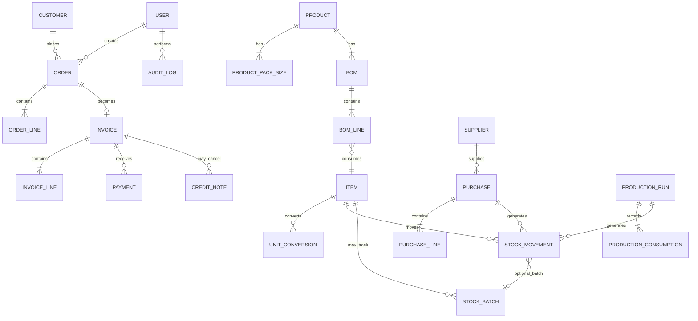

# Phase 0 Design Note

## Assumption

Ledger quantities use base units: grams for kg, millilitres for litres, and pieces for count items. UI quantities are converted at the edge.

## ER diagram

## Model decisions

- `StockMovement` is the source of truth. Each row has positive `qty_in` and `qty_out` Decimal values in the item's base unit.
- Movements are append-only. Corrections insert adjustment or reversal movements.
- Source document fields trace movements to Purchase, ProductionRun, Invoice/Dispatch, Adjustment or CreditNote.
- Business logic is isolated in `services/`.
- Posted invoices cannot be deleted. Cancellation uses a CreditNote and reversing movements.

## Phase 1 implementation

The `Item.base_unit` is the ledger storage unit: grams for flour and spice, millilitres for oil, and pieces for pouches/cartons/packets. `UnitConversion` stores the display-to-base multiplier.

`StockMovement` stores positive `qty_in` and `qty_out` values, a positive/zero unit cost, movement type, source document type/id and user. Quantity and money fields use three decimal places and two decimal places respectively. Balances are calculated with `SUM(qty_in) - SUM(qty_out)` rather than overwritten.
