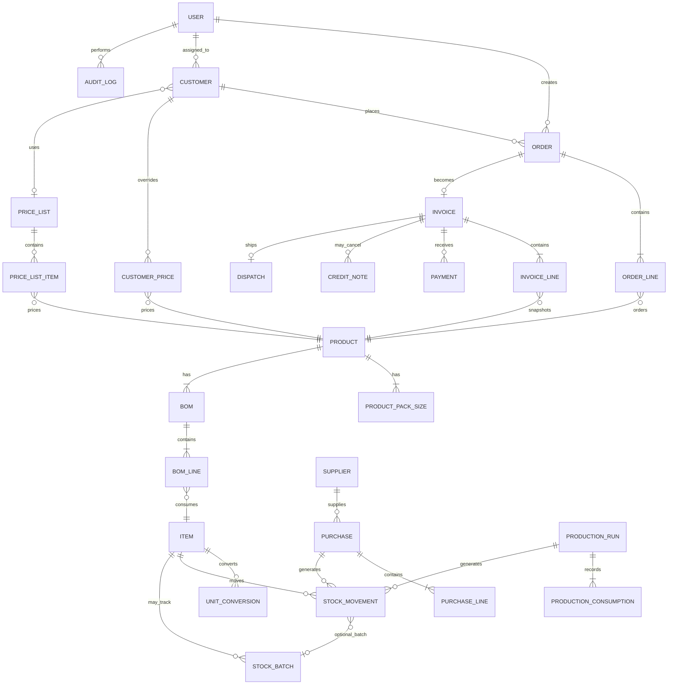

# Phase 0 Design Note

## Assumption

Ledger quantities use base units: grams for kg, millilitres for litres, and pieces for count items. UI quantities are converted at the edge.

## ER diagram

## Model decisions

- `StockMovement` is the source of truth. Each row has positive `qty_in` and `qty_out` Decimal values in the item's base unit.
- Movements are append-only. Corrections insert adjustment or reversal movements.
- Source document fields trace movements to Purchase, ProductionRun, Invoice/Dispatch, Adjustment or CreditNote.
- Business logic is isolated in `services/`.
- Posted invoices cannot be deleted. Cancellation uses a CreditNote and reversing movements.

## Phase 1 implementation

The `Item.base_unit` is the ledger storage unit: grams for flour and spice, millilitres for oil, and pieces for pouches/cartons/packets. `UnitConversion` stores the display-to-base multiplier.

`StockMovement` stores positive `qty_in` and `qty_out` values, a positive/zero unit cost, movement type, source document type/id and user. Quantity and money fields use three decimal places and two decimal places respectively. Balances are calculated with `SUM(qty_in) - SUM(qty_out)` rather than overwritten.

## Production and valuation

Production quantities are defined by the selected product's BOM. Planned and actual quantities use each BOM line's unit and are converted with the item's stored unit conversions before being saved to the ledger. Wastage is recorded in its own movement, and only good finished packets are received into finished-goods stock.

Material consumption uses moving weighted-average cost per base unit, recalculated from ledger receipts and issues. The run absorbs packaging/material waste and its direct labour and power/gas overheads. Material line costs and total cost are rounded to two decimal places; total cost divided by good output is rounded half-up to determine cost per packet.

## Sales and finance

Sales orders are scoped by `Customer.assigned_salesman` for Salesman users and carry a client UUID for idempotent submissions. Admin and Owner approval stores per-line approved quantities; dispatch locks the finished-goods items and rechecks ledger balances before creating outbound movements. Invoice taxable values are rounded per line, then invoice tax is rounded per GST rate and allocated in cents to the lines so their totals reconcile. Payments reduce receivables; a full credit note is immutable and restores dispatched stock with reversal movements.
